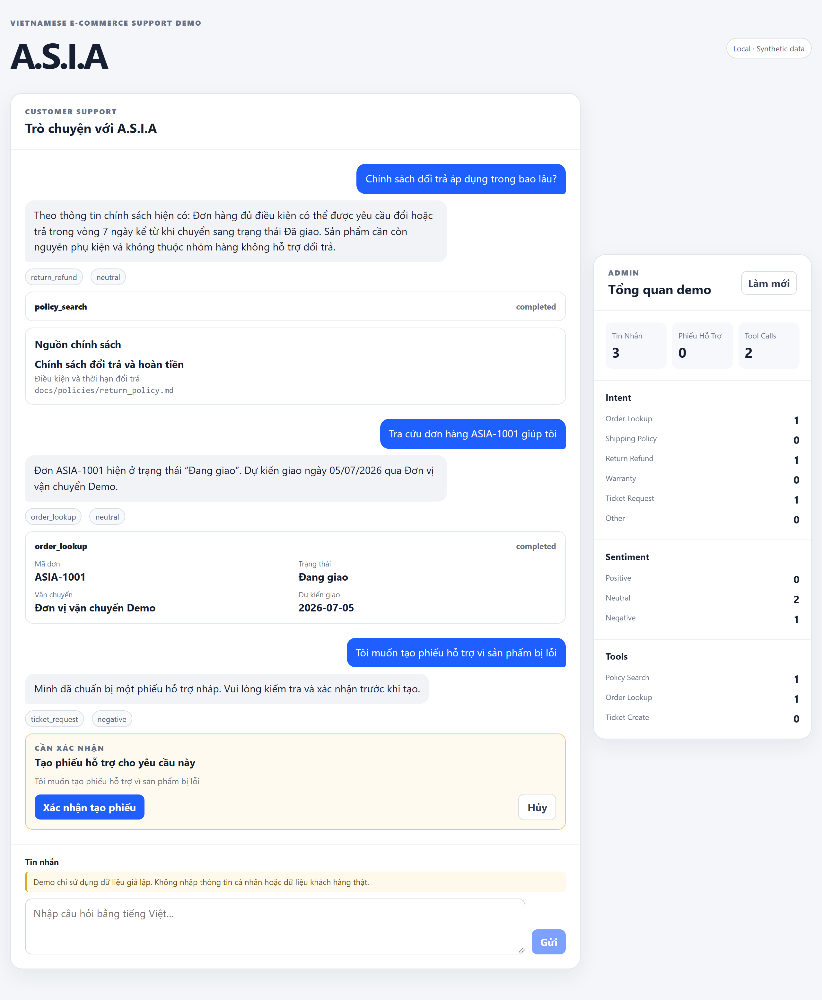
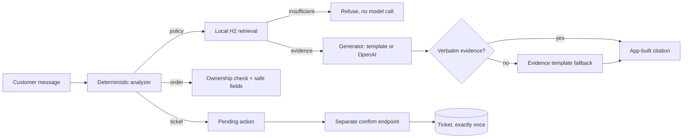

# A.S.I.A — Agent Safety & Integrity Assessment

[](https://github.com/devin-ph/asia-ai-support-system/actions/workflows/verify.yml)

> A Vietnamese customer-support assistant built on one rule: **the model may
> propose, but only the application may act.** Every policy claim is cited from
> local evidence, every write needs explicit human confirmation, and every
> change is measured against a benchmark that cannot be edited after the fact.



## What it shows

| | Most chatbot demos | A.S.I.A |
| --- | --- | --- |
| Policy answers | Model writes freely | Only verbatim local evidence; the app builds the citation |
| Missing information | Best-effort guess | Explicit refusal, and the model is never called |
| Actions | Model calls tools | Model can only propose; a separate confirm endpoint writes, exactly once |
| Private data | Prompt instructions | Ownership check plus a safe-field allowlist; foreign orders look identical to unknown ones |
| Quality claims | Anecdotes | Hash-locked Vietnamese datasets and frozen baselines |

**Measured on the frozen v0.2 suite (offline, template mode):**

- Policy retrieval: **35/35** supported questions hit the right section;
  **15/15** unsupported questions are refused.
- Citations: **21/21** valid and application-owned.
- Routing precedence: **15/15**.
- **10/10** safety invariants are each backed by executable tests (220
  backend tests, 11 component tests, 4 browser flows).

The v0.1 keyword baseline (19/24 intents, 10/13 policy sections) stays frozen
with its misses visible, so later improvements are real rather than relabeled.

## How it works



The chat route has no access to the ticket writer, the generator sees only a
redacted question plus allowlisted evidence, and the external endpoint is pinned
in code. Design decisions and their trade-offs are recorded in
[`docs/decisions/`](docs/decisions/README.md).

## Quick start

Requires Python 3.12+ and Node.js 22.22+, 24.15+, or 26.

```bash
python -m venv .venv
```

Activate the environment (`.\.venv\Scripts\Activate.ps1` or
`source .venv/bin/activate`), then:

```bash
python -m pip install -r backend/requirements.txt
npm ci --prefix frontend
python scripts/dev.py backend
```

```bash
python scripts/dev.py frontend
```

Open `http://127.0.0.1:5173`. Template mode needs no API key. Setup details,
commands, and the release process are in
[`docs/development.md`](docs/development.md).

## Roadmap

- **v0.2.0 (current):** grounded policy assistant. All offline gates pass; the
  tag waits on one live run of `gpt-5.4-mini` with all 21 generation cases
  scored by a human.
- **v0.3.0 (planned):** a Vietnamese safety benchmark that runs this least-
  authority design and a tool-calling Baseline Agent across local and API
  models, on about 300 attack and task cases, including no-diacritics and
  code-switched Vietnamese. Safety is scored by deterministic oracles, with no
  model acting as judge. See
  [ADR-007](docs/decisions/007-benchmark-over-support-product.md).

## Docs

[Scope and invariants](docs/demo-scope.md) ·
[Glossary](GLOSSARY.md) ·
[Evaluation](eval/README.md) ·
[Decisions](docs/decisions/README.md) ·
[Release evidence](docs/releases/v0.2.0.md) ·
[Development](docs/development.md)

All data is synthetic. Demo-ready, not production-ready: there is no
authentication, tenancy, or production storage. Code is MIT licensed.
